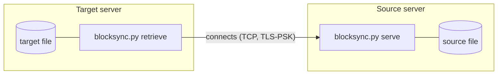
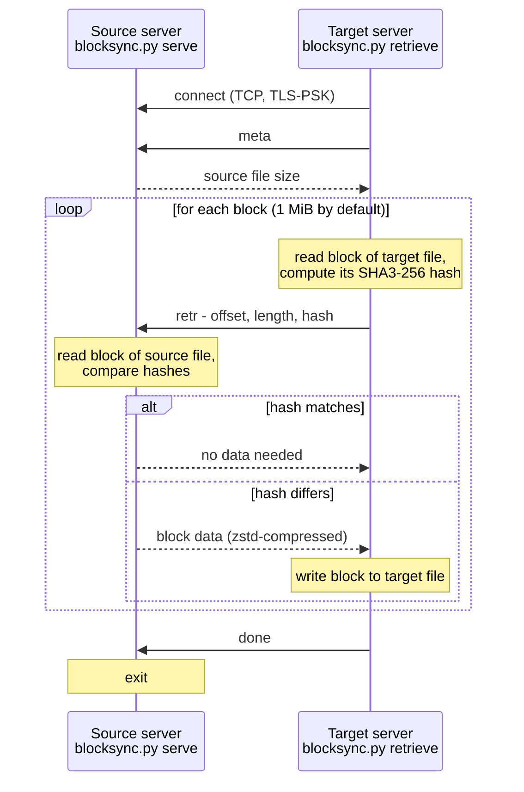

# blocksync

Copy large files (VM images, LVM snapshots etc.) between Linux servers.



> **Status: work in progress.**
> This README describes the agreed design.
> `blocksync.py` is only a skeleton so far - `serve` and `retrieve` are not implemented yet.

Features:

- Encryption and authentication using TLS-PSK
- Compression using Zstandard
- Incremental - only blocks with differing hash are transferred
- Python standard library only - no libraries or venv required
- Single `.py` file - trivial to copy or deploy wherever you need

Python version support:

- TLS-PSK support needs Python 3.13+
- Zstandard support needs Python 3.14+, or 3.13 with [backports.zstd](https://pypi.org/project/backports.zstd/)
- Python versions 3.12 and older are not supported
  - Use `uv run --python 3.14 blocksync.py ...` to run this script with managed Python

## Goals and non-goals

blocksync is meant for one-off copying of one large file or block device to another server,
especially when a (possibly outdated) copy already exists on the target, so that only the changed blocks need to be transferred.

Why not something else:

- `dd | ssh` always transfers everything.
- `rsync` needs special options to work with block devices (`--inplace`, `--copy-devices`, `--write-devices`),
  and its rolling checksum is slow on files of this size.
  blocksync compares only blocks at the same offset, which is enough for disk images.

Non-goals and limitations:

- **The source must not change during the transfer.**
  Use a snapshot (e.g. LVM snapshot) or stop whatever writes to the source.
  blocksync does not detect a changing source; the result would be an inconsistent copy.
- Pull only: the target side (`retrieve`) connects to the source side (`serve`).
  The target must be able to reach the TCP port of the source; there is no reverse mode.
  If the source is behind NAT, consider using IPv6 - it typically works
  even between individual VMs on hosts that share a single IPv4 address.
  Another option is a VPN such as [Tailscale](https://tailscale.com/), which connects servers behind NAT directly to each other.
- One file per run. No directories, no file metadata (owner, permissions, mtime).
- No continuous replication - `serve` exits after one successful transfer.
- Holes in sparse files are not preserved and no discard/TRIM is issued:
  changed blocks containing only zeros are written as ordinary data.
  A new target file is therefore fully allocated, and so is a thin-provisioned volume.
- The target is written in place, see [Interrupted transfer](#interrupted-transfer).

## Installation

Copy `blocksync.py` to both servers and run it. Nothing else is needed.

Alternatively, install it as the `blocksync` command:

```shell
uv tool install git+https://github.com/messa/blocksync
```

## Usage

Simplest use - let `serve` choose a random port and generate a random pre-shared key:

```shell
# Source side
blocksync.py serve --src-file /dev/vg0/vm_example_root
```

`serve` prints a ready-to-use `retrieve` command, for example:

```shell
# Target side
blocksync.py retrieve \
    --host source.example.com \
    --port 40123 \
    --psk 'z8kQ...' \
    --target-file /dev/vg0/vm_example_root
```

The printed host name is the FQDN as the source server knows it.
It may not be resolvable or reachable from the target - replace it with a suitable host name or IP address if needed.
`serve` listens on both IPv4 and IPv6, so an IPv6 address can be used as `--host` when the source has no public IPv4 address.

With an explicit port and a pre-shared key file:

```shell
# Create pre-shared key file and copy it to both sides
openssl rand -base64 512 > pre-shared-key

# Source side
blocksync.py serve \
    --port 9001 \
    --psk-file pre-shared-key \
    --src-file /dev/vg0/vm_example_root

# Target side
blocksync.py retrieve \
    --host source.example.com \
    --port 9001 \
    --psk-file pre-shared-key \
    --target-file /dev/vg0/vm_example_root
```

### Options

`serve`:

| Option | Description |
| --- | --- |
| `--src-file PATH` | Source file or block device. Required. |
| `--port PORT` | TCP port to listen on. Default: random unused port. |
| `--bind ADDRESS` | IP address to listen on. Default: all interfaces, IPv4 and IPv6. |
| `--psk VALUE` | Pre-shared key. |
| `--psk-file PATH` | File containing the pre-shared key. |
| `--insecure` | No TLS, no key. |

If none of `--psk`, `--psk-file` and `--insecure` is given, `serve` generates a random key.

`retrieve`:

| Option | Description |
| --- | --- |
| `--host HOST` | Host name or IP address of the source server. Required. |
| `--port PORT` | TCP port of the source server. Required. |
| `--target-file PATH` | Target file or block device. Required. |
| `--psk VALUE` | Pre-shared key. |
| `--psk-file PATH` | File containing the pre-shared key. |
| `--insecure` | No TLS, no key. |
| `--block-size BYTES` | Block size in bytes. Default: 1 MiB (1048576). Minimum: 1, maximum: 64 MiB. |

One of `--psk`, `--psk-file` or `--insecure` is required for `retrieve`.

### Exit codes

| Code | Meaning |
| --- | --- |
| 0 | `retrieve`: the transfer was completed. `serve`: one transfer was completed (`done` command received). |
| 1 | Error - connection failed, I/O error, target too small, protocol error etc. Details are logged to stderr. |
| 2 | Invalid command line options. |

### Interrupted transfer

The target is written in place.
If `retrieve` fails or is interrupted, the target contains a mix of old and new blocks and must not be used.

To fix it, simply run `retrieve` again.
`serve` keeps running after a failed connection, and blocks that were already transferred are not transferred again.

### Verifying the result

Data in transit is protected by TLS (unless `--insecure` is used), but there is no final whole-file checksum.

To verify the copy, run `serve` and `retrieve` again.
If the copy is identical, the progress output of the second run shows that no blocks were transferred.

## Security

- **The pre-shared key must be random, not a password.**
  The key is hashed only with plain SHA-256, which is not a password hashing function,
  so a short or guessable key can be found by offline brute force.
  Use the key generated by `serve`, or generate one with `openssl rand -base64 512`.
- `--psk VALUE` is visible in the process list (`ps`) and usually ends up in the shell history.
  `serve` also prints the generated key to stdout.
  On servers shared with other users prefer `--psk-file` with a file readable only by you.
- Whoever has the key can read the whole source file.
- By default `serve` listens on all interfaces. Use `--bind` to restrict it to one address.
- With `--insecure`, **anyone** who can connect to the port can read the source file,
  and the data is protected neither against eavesdropping nor against modification in transit.
  Use `--insecure` only over secure connections, e.g. VPN, and preferably together with `--bind`.

## Low-level details

### Pre-shared key

The key is given by `--psk VALUE` or `--psk-file PATH`.
Leading and trailing whitespace is stripped; the actual TLS key is SHA-256 of the remaining bytes.
So `--psk VALUE` and `--psk-file` with a file containing `VALUE` are equivalent.

TLS 1.3 is used, with PSK identity `blocksync`.

If you specify `--insecure`, TLS-PSK is not used and no pre-shared key is needed.
`--insecure` must be used on both sides.

Options `--psk`, `--psk-file` and `--insecure` are mutually exclusive.

### `serve`

Listens on the given TCP port (all interfaces, IPv4 and IPv6, unless `--bind` is given).
Incoming connections are wrapped in TLS-PSK using the pre-shared key.

If you don't provide `--port`, a random unused TCP port is chosen.

If you don't provide `--psk`, `--psk-file` or `--insecure`, a random key is generated.

On start, `serve` prints an example `retrieve` command to stdout.
It contains the host name (FQDN) of the server, the port, the key option (including the generated key value) and the `--src-file` path as `--target-file`.
Logs go to stderr.

`serve` is single-purpose: it exits after one successful transfer (`done` command).
Failed connections (wrong key, dropped connection, ...) are logged and `serve` keeps waiting, so `retrieve` can be simply run again.

Connections are handled independently of each other, so a stuck client does not block other clients.
When one connection completes the transfer (`done`), `serve` closes all other connections and exits.

A connection is closed if the TLS handshake does not finish within 30 seconds
or if no complete command is received for 5 minutes.

#### Protocol

After the client connects (and the TLS-PSK handshake succeeds, unless `--insecure` is used):

1. Server sends `blocksync/1\n`
2. Client sends commands and server responds to them in the same order.
   Client does not need to wait for a response before sending the next command (pipelining).

If the client receives anything other than `blocksync/1\n`, it closes the connection and ends with an error.

Typical session:



Each command is 4 ASCII bytes followed by its params.
All integers are unsigned big-endian.

Commands:

- `meta`
  - Retrieve source file metadata
  - Params: none
  - Response:
    - `length` (uint32): size of `data` in bytes
    - `data` (of given `length`): UTF-8 JSON-encoded object
      - `"size"`: size of the source file in bytes
    - The client must ignore unknown keys in the object.
- `nozs`
  - Do not use Zstandard compression in responses to the following `retr` commands
  - Params: none
  - Response:
    - `ok` (1 byte): the value `b'1'`
  - Sent by a client that cannot decompress Zstandard, before the first `retr`.
- `retr`
  - Retrieve source file block, if its hash differs
  - Params:
    - `offset` (uint64): offset of the block in the file (in bytes)
    - `length` (uint32): length of the block (in bytes), at least 1 and at most 64 MiB
    - `hash` (32 bytes): SHA3-256 of the target block contents
  - Response:
    - `code` (1 byte)
      - `\x00`: hash matches, no data need to be returned
      - `\x01`: hash mismatch, returning raw block data
      - `\x02`: hash mismatch, returning Zstandard-compressed block data
      - `\x03`: error, returning UTF-8 error message
    - `length` (uint32): size of `data` in bytes
    - `data` (of given `length`): raw or zstd-compressed contents of the block, error message, or nothing if the hash matches
  - Server returns compressed data only if it is smaller than raw data and the client did not send `nozs`.
  - Code `\x03` means that the server could not read the block from the source file (I/O error).
    The server closes the connection after sending this response; the client logs the message and ends with an error.
- `done`
  - Transfer is completed
  - Params: none
  - Response:
    - `ok` (1 byte): the value `b'1'`
    - Both sides close the TCP connection.

Invalid requests are protocol violations.
The server logs the reason and closes the connection without sending a response (and keeps waiting for another connection):

- unknown command
- `retr` with `length` 0 or larger than 64 MiB
- `retr` with a block extending beyond the end of the source file

If running under Python 3.13 and `backports.zstd` is not present, Zstandard compression is not used.

### `retrieve`

Options `--host`, `--port` and one of `--psk`, `--psk-file` or `--insecure` are required.

1. Connect to the server and receive `blocksync/1\n`.
2. Retrieve metadata (`meta`).
   If Zstandard is not available, send `nozs`.
3. Check the target:
   - Block device must be at least as large as the source file, otherwise `retrieve` ends with an error before writing anything.
     If it is larger, the part beyond the source file size is left untouched.
   - Regular file is created if it does not exist; it is never truncated before the transfer.
4. Read target blocks (default block size 1 MiB, see `--block-size`), compute their hashes and send them to the server (`retr`).
   A limited number of `retr` commands is sent ahead without waiting for responses.
   - The last block is shorter if the source file size is not a multiple of the block size.
   - If the target file is shorter than the source file (or was just created), the hash is computed from the data that is there -
     possibly fewer bytes than the block length, or no bytes at all. Such a hash never matches, so the block is transferred.
5. Receive responses and write changed blocks to the target in place.
6. Truncate a regular file to the source file size and `fsync` the target.
7. Send `done` and wait for the response.

The target is synced before `done` is sent, because `serve` exits after `done`.
If the truncate or `fsync` fails, `serve` is still running and `retrieve` can be run again.

Blocks are read and hashed using a thread pool so that hashing does not become a bottleneck.
The bottleneck should be disk read I/O or network speed.

Progress is printed to stderr.

`retrieve` ends with an error if it does not receive any data from the server for 5 minutes while waiting for a response.

Receiving a `retr` response with `code` `\x02` after sending `nozs` is a protocol error.

## Development

Requires [uv](https://docs.astral.sh/uv/).

```shell
uv sync                    # create .venv with dev tools
uv run ruff check          # lint
uv run ruff format         # format
uv run mypy                # type check
uv run pytest              # tests
```
